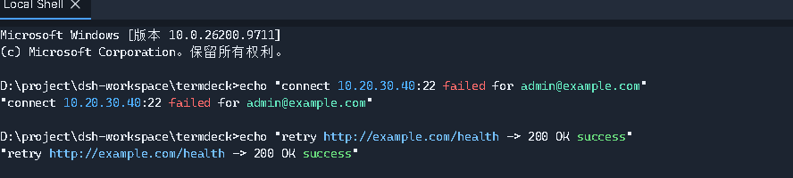

<div align="center">

# TermDeck

**为「同时连着很多台机器」准备的 SSH / 终端客户端**

多窗格分屏 · 内置 SFTP · 片段库 · REST / S3 / 端口转发


[功能](#功能) · [截图](#截图) · [安装](#安装) · [快捷键](#快捷键) · [从源码构建](#从源码构建) · **English** → [docs/README-en.md](docs/README-en.md)


*一个窗口两块窗格，输入可以只发给当前窗格，也可以广播给全部。*

</div>

## 为什么是 TermDeck

因为「同时开五六台机器的终端」这件事，现有工具要么得开六个窗口，要么在切来切去上花掉大半时间。
TermDeck 把三件事做进同一个窗口：

- **窗格就是工作区**：标签拖到边缘即分屏、拖到中间即合并成标签组，分错了随时一键重排；
- **连接不只在终端里**：同一个界面里有 SFTP、端口转发、REST、S3 —— 查日志、传文件、调接口不用离开这个窗口；
- **不联网、不外传**：所有连接从本机直接发出，主机、凭证、历史、片段、调用记录都只存在你自己的机器上，
  密码用 AES-256-GCM 加密落盘。

## 功能

### 连接

| | |
| --- | --- |
| **SSH** | 密码 / 私钥 / 私钥口令 / ssh-agent / keyboard-interactive，全部走 `ssh2` |
| **本地 Shell** | ConPTY 真终端（`@lydell/node-pty`），和 SSH 窗格同一个界面、同一套快捷键 |
| **主机库** | 多层分组（**分组可折叠**，右键菜单可一键全部折叠 / 展开）、标签、卡片/列表两种视图、拖拽移动、**勾选后批量删除 / 复制 / 移动到分组**、批量添加（`10.0.0.1-10` 展开）、批量打标签 |
| **已知主机** | 浏览 `known_hosts` 每一条（含指纹），搜索、多选、批量遗忘；指纹变化时明确告警 |
| **导入导出** | 一个 `.tdshare` 文件 = gzip + AES-256-GCM 加密的主机与片段，换机器直接搬 |

### 终端与窗格


- **拖拽分屏**：拖到窗格左/右/上/下边缘 → 分屏；拖到另一个窗格中心 → 合并成标签组；分隔条可拖动调整
- **一键排列**：`Ctrl+Shift+T` 选择要排列的窗格（默认全选）＋瓷砖 / 竖屏 / 横屏 —— 只移动窗格，**不会断开任何会话**
- **广播输入**：`Ctrl+Shift+B`，一次输入发给所有可见窗格（批量改配置很好用）
- **断线重连**：可配置次数与间隔；**在后台静默进行**（不抢你正在用的窗格、不弹窗，失败原因写在该窗格自己的遮罩上）；重连保留同一个 session id，**历史输出都还在**，窗格尺寸也跟着变回来；结束的窗格**可以直接关掉，关掉就不再重试**；`Ctrl+R` 手动重连
- **`Ctrl+W` 不抢**：它是 readline 的"删掉前一个词"，默认留给 shell 用（想绑成关闭会话可以自己在快捷键里设）
- **输出高亮**：把 IP、链接、邮箱、MAC、路径、错误/警告/成功关键字上色，4 套配色（经典 / XShell 色块 / 柔和 / 单色），8 条规则逐条开关；**只改显示**，复制与保存的输出仍是远端原样文本
- **会话分组折叠**：抽屉会话区右上角一个按钮 `▾▾` / `▸▸` 一键折叠或打开**所有分组**（含嵌套），
  折叠状态按分组保留；搜索时会自动展开，搜得到就一定看得见
- **专注模式**（`F11`）、**锁屏**（`Ctrl+Alt+L`）、**番茄钟与休息提醒**、退出前二次确认

### 终端里的手感

- 双击选词：`:` `,` `;` 算分隔符，双击 `key:` 只选到 `key`
- 三击选整行，复制时**自动带一个换行**，可以直接粘成一行（普通拖选不会多出空行）
- 命令历史与补全：`↑`/`↓` 选，`Enter`/`Tab` **只填进命令行、不执行**；全局共享一份历史，**以空格开头的行不记录**
- 时间戳、输出另存为文件、会话结束后窗格保留并可从原连接或保存的主机重新连上

### 文件传输

- **SFTP 面板**：浏览远端目录、上传、下载、新建、重命名、删除
- **拖拽上传**：把文件从资源管理器拖到 SFTP 面板上，松手即传（也支持粘贴路径文本）
- **传输进度**：快捷指令栏上方自动出现的横条 —— 收起时也读得出文件名 / 方向 / 百分比 / 总速度，
  展开是完整列表（已传、剩余时间、取消）；传完保留记录，**✕ 只隐藏、⌫ 清空已完成**
- **多块并发**：下载和上传都是固定数量分块并行，**不再"一次一个来回"**；取消是真的取消

### 效率工具

| 工具 | 做什么 |
| --- | --- |
| **REST** | 直接向远端或本机接口发请求：两列布局（左边历史/已保存，右边请求/响应，页面本身不滚动）、请求头可整段粘 JSON、每次调用自动进历史并可一键存下改名 |
| **S3** | 浏览桶与对象，上传下载 |
| **端口转发** | 本地隧道，随连随用 |
| **日志** | 连接与操作日志，便于回溯 |
| **代码片段** | 长命令存成片段，带颜色与分组（分组可多选筛选），可绑全局快捷键，终端底部片段条一点即发 |

### 外观


13 套主题（深色为主，含浅色的 Blossom / Lavender），终端字体可换（自带 Roboto Mono / JetBrains Mono），
界面缩放 80%–150%，**中英文界面**（设置 → 外观 → 语言，选完立刻生效；REST 页已是整页中文，
S3 与端口转发两页还在补）。所有主题都通过对比度审计。

## 截图



*输出高亮：地址、链接、邮箱、错误与成功关键字按所选配色上色，复制出去仍是纯文本。*

| 主机库 | 代码片段 |
| --- | --- |
|  |  |


*REST：左边是调用历史与已保存的调用，右边是请求与响应 —— 页面不滚动，响应不会被挤到屏幕下面。*

## 安装

从 [Releases](https://github.com/lblacklewis/termdeck/releases) 下载：

**Windows（x64）**

| 文件 | 说明 |
| --- | --- |
| `TermDeck-Setup-<版本>.exe` | 安装版（可选安装目录、建快捷方式） |
| `TermDeck-<版本>-x64.exe` | 单文件便携版（每次启动解包，启动稍慢） |
| `TermDeck-<版本>-win-x64-portable.zip` | 解压即用，**推荐给别人的时候发这个** |

**macOS（arm64 / x64 两个包，不做 universal）**

| 文件 | 说明 |
| --- | --- |
| `TermDeck-<版本>-arm64.dmg` | Apple Silicon（M 系列） |
| `TermDeck-<版本>-x64.dmg` | Intel Mac |
| `TermDeck-<版本>-<架构>.zip` | 同一个 app 的压缩包 |

`SHA256SUMS-<版本>.txt` 里是 Windows 三个产物的校验值；mac 的 dmg / zip 由 CI 构建，
各带一份 `SHA256SUMS-<版本>-mac-<架构>.txt`。

**Windows 首次运行会被 SmartScreen 拦一下**：安装包没有代码签名证书，Windows 无法确认发布者，
点「更多信息 → 仍要运行」即可。也可以用 Mark-of-the-Web 的方式避免：右键文件 → 属性 →
勾选**解除锁定**；先解除 zip 再解压最干净。细节（包括证书要多少钱、怎么验签名）见
[docs/安装与信任.md](docs/安装与信任.md)。

**macOS 版没有签名、也没有公证**，第一次打开同样会被拦：

1. 在「访达」里 **右键（或按住 Control 点击）TermDeck.app → 打开**，再点一次「打开」；
2. 或者 `xattr -dr com.apple.quarantine /Applications/TermDeck.app`，之后就能正常双击；
3. 应用**换过位置**之后，之前存下的密码可能取不回来（mac 上加密走钥匙串），需要重新输一次。

## 快捷键

**两个平台各有自己的习惯，不是把 `Ctrl` 换成 `Cmd` 那么简单。** 比如复制粘贴：Windows/Linux 上是
`Ctrl+Shift+C/V`（`Ctrl+C` 要留给 shell 发 SIGINT），macOS 上就是每个 Mac 用户肌肉记忆里的
`Cmd+C/V`；全屏在 Windows 上是 `F11`，在 macOS 上是全系统统一的 `Ctrl+Cmd+F`。

| 作用 | Windows / Linux | macOS |
| --- | --- | --- |
| 新建连接 | `Ctrl`+`T` | `Cmd`+`T` |
| **关闭当前窗格** | 默认不绑定（见下） | `Cmd`+`W` |
| 关闭已结束的窗格 | `Ctrl`+`D` | 不需要（`Cmd`+`W` 关任何窗格） |
| 重连（会话已结束） | `Ctrl`+`R` | `Cmd`+`R` |
| **复制 / 粘贴** | `Ctrl`+`Shift`+`C` / `V` | `Cmd`+`C` / `V` |
| 下一个 / 上一个标签 | `Ctrl`+`Tab` / `Ctrl`+`Shift`+`Tab` | `Cmd`+`Shift`+`]` / `[` |
| 下一个 / 上一个会话 | `Alt`+`]` / `[` | `Cmd`+`Alt`+`→` / `←` |
| 跳到第 N 个会话 | `Alt`+数字 | `Cmd`+数字 |
| 广播输入 | `Ctrl`+`Shift`+`B` | `Cmd`+`Shift`+`B` |
| 传输窗口 | `Ctrl`+`Shift`+`J` | `Cmd`+`Shift`+`J` |
| 片段条开关 | `Ctrl`+`Shift`+`S` | `Cmd`+`Shift`+`S` |
| 一键排列窗格 | `Ctrl`+`Shift`+`T` | `Cmd`+`Shift`+`T` |
| 只改终端字号 | `Ctrl`+`=` / `-` | `Cmd`+`=` / `-` |
| 界面缩放 | `Ctrl`+`Shift`+`=` / `-` | `Cmd`+`Shift`+`=` / `-` |
| 专注模式（全屏） | `F11` | `Ctrl`+`Cmd`+`F` |
| 锁屏 | `Ctrl`+`Alt`+`L` | `Ctrl`+`Cmd`+`L` |
| 打开设置 | `Ctrl`+`,` | 菜单「TermDeck → 设置…」（`Cmd`+`,`） |
| 退出 | `Ctrl`+`Shift`+`Q` | 菜单「TermDeck → 退出」（`Cmd`+`Q`） |
| 关闭窗口 | 窗口的 × 按钮 | `Cmd`+`Shift`+`W` |

几点说明：

- **`Ctrl`+`W` 在 Windows / Linux 上默认不绑定**：它在 readline（bash / zsh / Python / Node REPL）里是
  "删掉前一个词"，应用不该抢。macOS 上 `Ctrl` 和 `Cmd` 是两个世界 —— `Ctrl` 归 shell、`Cmd` 归应用
  —— 所以那里 `Cmd`+`W` 就是"关闭当前窗格"，系统的关窗挪到了 `Cmd`+`Shift`+`W`。
- **macOS 上复制粘贴走的是 `Cmd`+`C` / `V`**：焦点在终端里就复制终端选区、粘贴到当前会话；焦点在设置
  或对话框的输入框里，则交给系统自己处理（两套不抢同一个键）。
- **macOS 上不会"选中即复制"**：Mac 的终端习惯是选中后按 `Cmd`+`C`（Windows 上的"选中即复制"保持原样）。
  右键粘贴两个平台都保留。
- 全部快捷键都能在 **设置 → 快捷键** 里改，冲突会标出来；macOS 上显示的修饰键是 `Cmd`。

## 从源码构建

```bash
npm install
npm run dev          # 开发模式
npm run verify       # 全部检查：类型、i18n、55 个探针
npm run dist:win     # Windows：安装包 + 便携版
npm run pack:zip     # Windows：解压即用的 zip
npm run dist:mac     # macOS：dmg + zip（arm64 与 x64）
```

需要 Node 20+；Windows 上本地 shell 依赖 ConPTY，macOS 上起的是 `$SHELL`（默认 zsh）。
**mac 的 dmg 只能在 Mac 上打**（要 `hdiutil`），仓库里的
[.github/workflows/mac.yml](.github/workflows/mac.yml) 会用两个 macOS runner 分别出 arm64 与 x64 包。
架构说明、发布流程与各处"为什么这么写"的决定，
见 [docs/README-en.md](docs/README-en.md) 与 [docs/交接-下一批需求.md](docs/交接-下一批需求.md)。

## 许可

MIT
