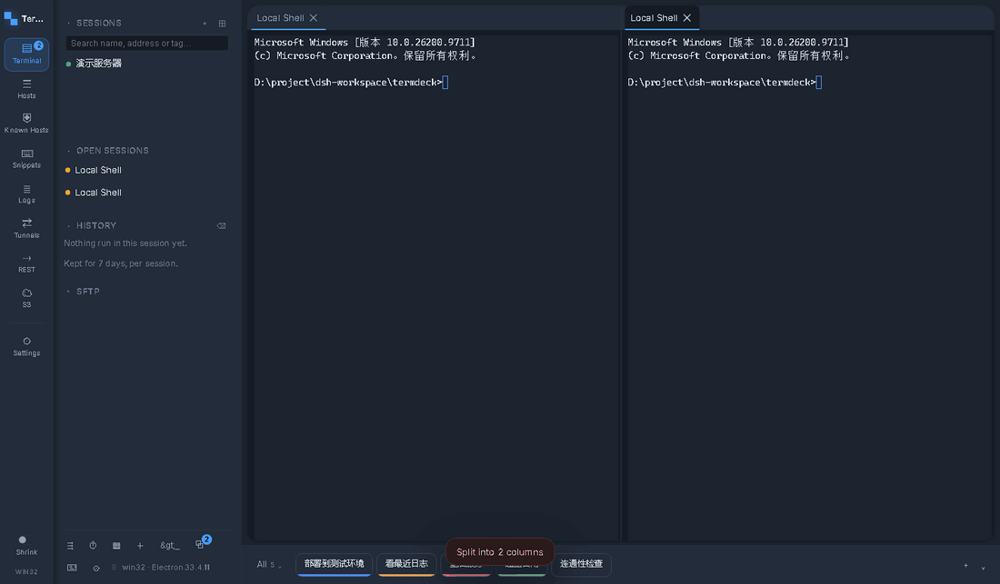
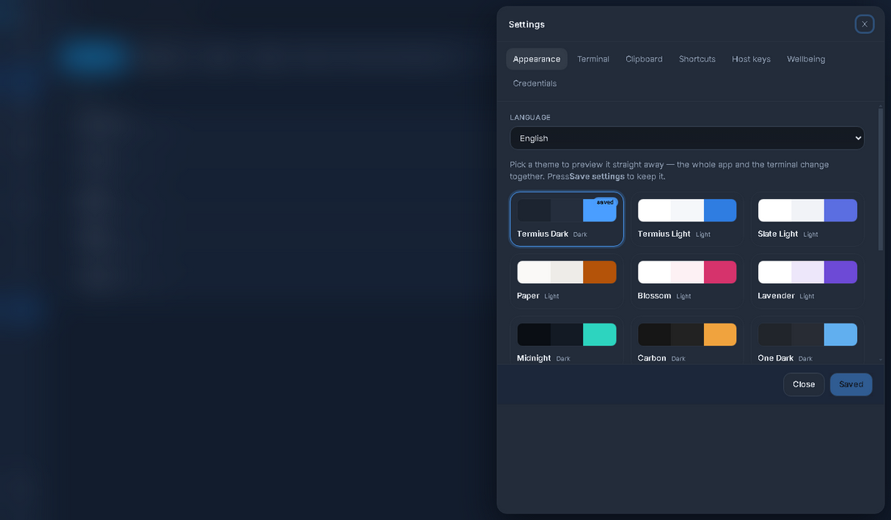
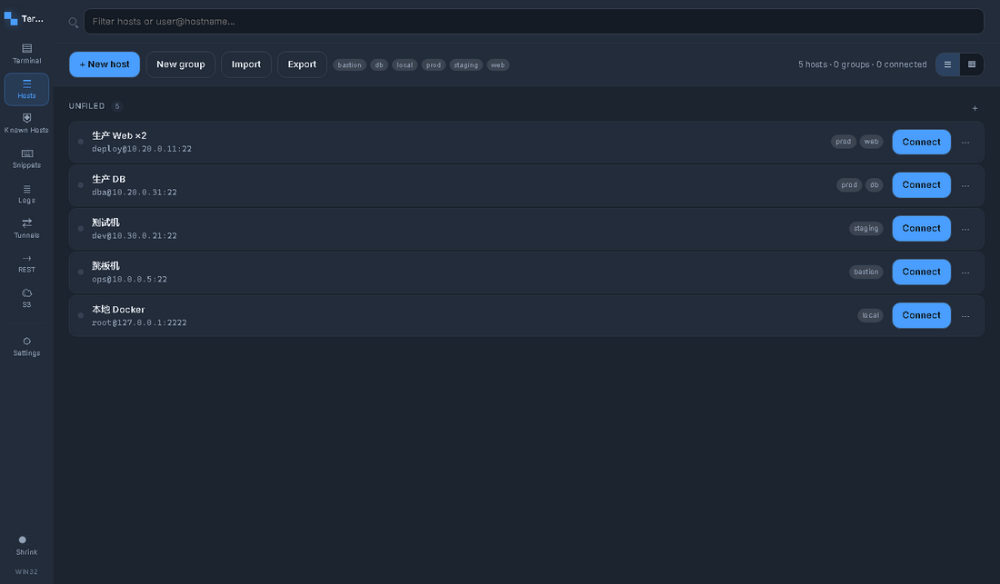
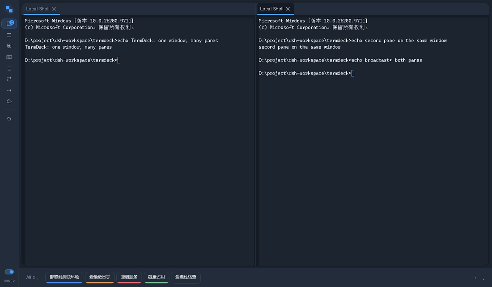
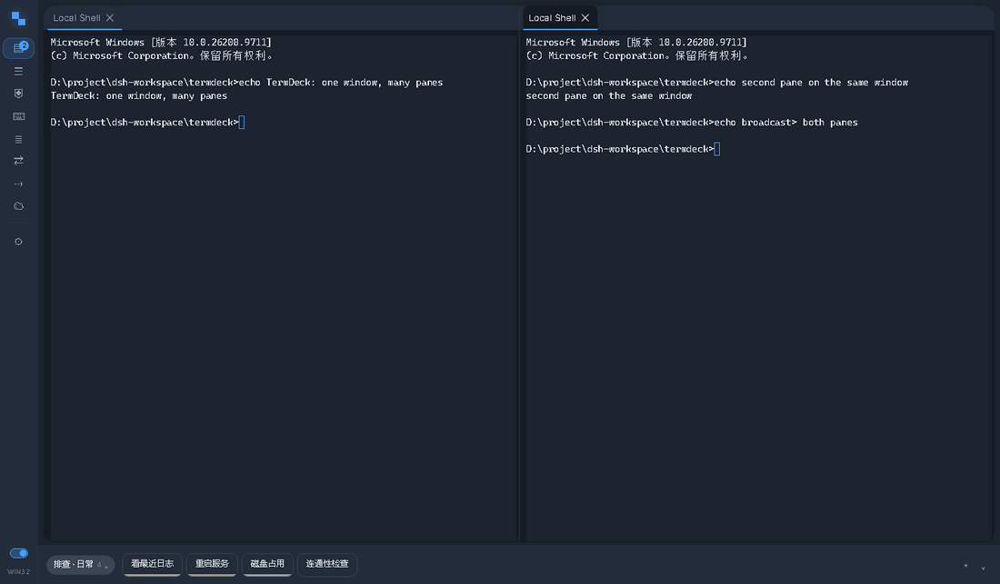

<div align="center">

# TermDeck

**为「同时连着很多台机器」准备的 SSH / 终端客户端**

多窗格分屏 · 内置 SFTP · 片段库 · REST / S3 / 端口转发


[功能](#功能) · [截图](#截图) · [安装](#安装) · [快捷键](#快捷键) · [从源码构建](#从源码构建) · **English** → [docs/README-en.md](docs/README-en.md)



*一个窗口两块窗格，输入可以只发给当前窗格，也可以广播给全部。*

</div>

## 为什么是 TermDeck

因为「同时开五六台机器的终端」这件事，现有工具要么得开六个窗口，要么在切来切去上花掉大半时间。
TermDeck 把三件事做进同一个窗口：

- **窗格就是工作区**：标签拖到边缘即分屏、拖到中间即合并成标签组，分错了随时一键重排；
- **连接不只在终端里**：同一个界面里有 SFTP、端口转发、REST、S3 —— 查日志、传文件、调接口不用离开这个窗口；
- **不联网、不外传**：所有连接从本机直接发出，主机、凭证、历史、片段、调用记录都只存在你自己的机器上，
  密码用 AES-256-GCM 加密落盘。

## 功能

### 连接

| | |
| --- | --- |
| **SSH** | 密码 / 私钥 / 私钥口令 / ssh-agent / keyboard-interactive，全部走 `ssh2` |
| **本地 Shell** | ConPTY 真终端（`@lydell/node-pty`），和 SSH 窗格同一个界面、同一套快捷键 |
| **主机库** | 多层分组（**分组可折叠**，右键菜单可一键全部折叠 / 展开）、标签、卡片/列表两种视图、拖拽移动、批量添加（`10.0.0.1-10` 展开）、批量打标签 |
| **已知主机** | 浏览 `known_hosts` 每一条（含指纹），搜索、多选、批量遗忘；指纹变化时明确告警 |
| **导入导出** | 一个 `.tdshare` 文件 = gzip + AES-256-GCM 加密的主机与片段，换机器直接搬 |

### 终端与窗格


- **拖拽分屏**：拖到窗格左/右/上/下边缘 → 分屏；拖到另一个窗格中心 → 合并成标签组；分隔条可拖动调整
- **一键排列**：`Ctrl+Shift+T` 选择要排列的窗格（默认全选）＋瓷砖 / 竖屏 / 横屏 —— 只移动窗格，**不会断开任何会话**
- **广播输入**：`Ctrl+Shift+B`，一次输入发给所有可见窗格（批量改配置很好用）
- **断线重连**：可配置次数与间隔；重连保留同一个 session id，**历史输出都还在**；`Ctrl+R` 手动重连
- **会话分组折叠**：抽屉会话区右上角一个按钮 `▾▾` / `▸▸` 一键折叠或打开**所有分组**（含嵌套），
  折叠状态按分组保留；搜索时会自动展开，搜得到就一定看得见
- **专注模式**（`F11`）、**锁屏**（`Ctrl+Alt+L`）、**番茄钟与休息提醒**、退出前二次确认

### 终端里的手感

- 双击选词：`:` `,` `;` 算分隔符，双击 `key:` 只选到 `key`
- 三击选整行，复制时**自动带一个换行**，可以直接粘成一行（普通拖选不会多出空行）
- 命令历史与补全：`↑`/`↓` 选，`Enter`/`Tab` **只填进命令行、不执行**；全局共享一份历史，**以空格开头的行不记录**
- 时间戳、输出另存为文件、会话结束后窗格保留并可从原连接或保存的主机重新连上

### 文件传输

- **SFTP 面板**：浏览远端目录、上传、下载、新建、重命名、删除
- **拖拽上传**：把文件从资源管理器拖到 SFTP 面板上，松手即传（也支持粘贴路径文本）
- **传输进度**：快捷指令栏上方自动出现的横条 —— 收起时也读得出文件名 / 方向 / 百分比 / 总速度，
  展开是完整列表（已传、剩余时间、取消）；传完保留记录，**✕ 只隐藏、⌫ 清空已完成**
- **多块并发**：下载和上传都是固定数量分块并行，**不再"一次一个来回"**；取消是真的取消

### 效率工具

| 工具 | 做什么 |
| --- | --- |
| **REST** | 直接向远端或本机接口发请求：两列布局（左边历史/已保存，右边请求/响应，页面本身不滚动）、请求头可整段粘 JSON、每次调用自动进历史并可一键存下改名 |
| **S3** | 浏览桶与对象，上传下载 |
| **端口转发** | 本地隧道，随连随用 |
| **日志** | 连接与操作日志，便于回溯 |
| **代码片段** | 长命令存成片段，带颜色与分组（分组可多选筛选），可绑全局快捷键，终端底部片段条一点即发 |

### 外观



13 套主题（深色为主，含浅色的 Blossom / Lavender），终端字体可换（自带 Roboto Mono / JetBrains Mono），
界面缩放 80%–150%，**中英文界面**（设置 → 外观 → 语言，选完立刻生效；REST 页已是整页中文，
S3 与端口转发两页还在补）。所有主题都通过对比度审计。

## 截图

| 主机库 | 代码片段 |
| --- | --- |
|  |  |



*REST：左边是调用历史与已保存的调用，右边是请求与响应 —— 页面不滚动，响应不会被挤到屏幕下面。*

## 安装

从 [Releases](https://github.com/lblacklewis/termdeck/releases) 下载：

| 文件 | 说明 |
| --- | --- |
| `TermDeck-Setup-<版本>.exe` | 安装版（可选安装目录、建快捷方式） |
| `TermDeck-<版本>-x64.exe` | 单文件便携版（每次启动解包，启动稍慢） |
| `TermDeck-<版本>-win-x64-portable.zip` | 解压即用，**推荐给别人的时候发这个** |
| `SHA256SUMS-<版本>.txt` | 校验值 |

**首次运行会被 SmartScreen 拦一下**：安装包没有代码签名证书，Windows 无法确认发布者，点「更多信息 → 仍要运行」即可。
也可以用 Mark-of-the-Web 的方式避免：右键文件 → 属性 → 勾选**解除锁定**；先解除 zip 再解压最干净。
细节（包括证书要多少钱、怎么验签名）见 [docs/安装与信任.md](docs/安装与信任.md)。

## 快捷键

| 键 | 作用 |
| --- | --- |
| `Ctrl` + `T` | 新建连接 |
| `Ctrl` + `W` | 关闭当前窗格 |
| `Ctrl` + `D` | 会话已结束时关闭窗格（活着的 shell 里仍是 EOF） |
| `Ctrl` + `R` | **重连**（会话结束、或从上次布局恢复出来的窗格） |
| `Ctrl` + `Shift` + `B` | 广播输入 |
| `Ctrl` + `Shift` + `J` | 传输窗口 |
| `Ctrl` + `Shift` + `S` | 片段条开关 |
| `Ctrl` + `Shift` + `T` | 一键排列窗格 |
| `Ctrl` + `=` / `Ctrl` + `-` | 只改终端字号 |
| `Ctrl` + `Shift` + `=` / `-` | 界面缩放 |
| `F11` | 专注模式 |
| `Ctrl` + `Alt` + `L` | 锁屏 |
| `Alt` + 数字 / `Alt` + `[` `]` | 切换会话（跨分组，首尾循环） |

全部快捷键都能在 **设置 → 快捷键** 里改，冲突会标出来。

## 从源码构建

```bash
npm install
npm run dev          # 开发模式
npm run verify       # 全部检查：类型、i18n、50 个探针套件
npm run dist:win     # 安装包 + 便携版
npm run pack:zip     # 解压即用的 zip
```

需要 Node 20+ 与 Windows（本地 shell 依赖 ConPTY）。架构说明、发布流程与各处"为什么这么写"的决定，
见 [docs/README-en.md](docs/README-en.md) 与 [docs/交接-下一批需求.md](docs/交接-下一批需求.md)。

## 许可

MIT
